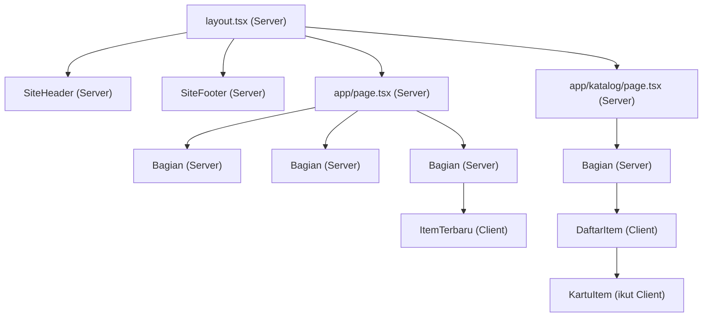

# Dokumen Teknis Modul 3 — TypeScript dan Komponen React

Nama/NIM : [ISI: Nama Lengkap] / [ISI: NIM]
Repositori : [ISI: https://github.com/username/nama-repo]

> Catatan: contoh di bawah memakai entitas `Item` dengan kategori energi, lingkungan, dan kampus, sesuai modul. Jika produkmu memakai nama lain, samakan dengan kode di repositori.

---

## 1. Tipe Data Produk

Isi `lib/tipe.ts`:

```ts
export type Kategori = "energi" | "lingkungan" | "kampus";

export interface Item {
  id: number;
  judul: string;
  kategori: Kategori;
  deskripsi: string;
  tersedia: boolean;
  gambar?: string;
}
```

**Alasan pemilihan tipe:**

- **Union type `Kategori`** membatasi nilai kategori hanya pada pilihan yang sah. Ketika saya sengaja mengubah kategori salah satu item menjadi `"transportasi"`, `npx tsc --noEmit` langsung melaporkan galat TS2322, sehingga salah ketik terdeteksi sebelum aplikasi dijalankan.
- **Properti opsional `gambar?`** dipilih karena tidak semua item memiliki gambar. Item tanpa gambar tetap valid dan tidak perlu diisi nilai kosong palsu.
- **`interface` untuk `Item`** dipilih karena `Item` adalah entitas data berbentuk objek yang dapat diperluas (`extends`) bila produk berkembang. `type alias` dipakai untuk union (`Kategori`) dan bentuk sederhana (`Tautan`).
- **`Record<Kategori, string>`** dipakai pada `KartuItem` untuk label kategori, sehingga bila kategori baru ditambahkan, pemeriksa tipe melaporkan label yang belum dibuat.

Bukti galat tipe saat percobaan `"transportasi"`:


Setelah percobaan, nilai dikembalikan ke `"energi"` dan `npx tsc --noEmit` kembali tanpa galat.

---

## 2. Struktur Komponen

### Diagram pohon komponen akhir



### Tabel komponen

| Komponen | Props dan tipenya | Digunakan di |
|---|---|---|
| `SiteHeader` | `namaProduk: string`, `tautan: Tautan[]` | `app/layout.tsx` |
| `SiteFooter` | `namaProduk: string` | `app/layout.tsx` |
| `Bagian` | `id: string`, `judul: string`, `children: React.ReactNode` | `app/page.tsx` (fitur, kontak, item terbaru), `app/katalog/page.tsx` |
| `KartuItem` | `item: Item` | `DaftarItem` (dipakai berulang untuk setiap hasil) |
| `DaftarItem` | `items: Item[]` | `app/katalog/page.tsx` |
| `ItemTerbaru` | tanpa props | `app/page.tsx` |

> [ISI: sesuaikan kolom "Digunakan di" dengan kode aslimu.]

### Alasan pemecahan komponen dan penempatan `"use client"`

- **Pemecahan komponen** dilakukan untuk menghilangkan duplikasi. `Bagian` dipakai berulang sehingga pola `<section>` dengan `<h2>` dan `aria-labelledby` tidak ditulis ulang di setiap halaman. `SiteHeader` dan `SiteFooter` dipindahkan ke `layout.tsx` agar tampil konsisten di semua halaman tanpa disalin.
- **Props bertipe** membuat kontrak tiap komponen eksplisit. Kesalahan seperti salah nama prop atau tipe yang tidak sesuai terdeteksi oleh `tsc`.
- **`"use client"` hanya ditempatkan di `DaftarItem` dan `ItemTerbaru`**, karena hanya keduanya yang memerlukan `useState`, `useEffect`, dan event handler. Komponen lain tidak memerlukan interaktivitas sehingga tetap Server Component dan JavaScript-nya tidak dikirim ke peramban.
- **`KartuItem` tidak diberi direktif sendiri**, tetapi karena diimpor oleh `DaftarItem` (Client Component), ia ikut menjadi bagian dari Client Component.
- **`app/katalog/page.tsx` tetap Server Component** dan hanya meneruskan data tiruan ke `DaftarItem` melalui props. Dengan begitu, batas Client Component sedalam mungkin pada pohon komponen.

---

## 3. State dan Interaksi

Tangkapan layar tab Components pada komponen `DaftarItem`, memperlihatkan props `items` dan dua state `kataKunci` serta `filter`:


Halaman `/katalog` setelah berhasil menampilkan daftar item:


`DaftarItem` memiliki:

- props `items: Item[]`;
- state `kataKunci` bertipe `string`, nilai awal `""`;
- state `filter` bertipe `Filter` (`Kategori | "semua"`), nilai awal `"semua"`.

### Alur dari event hingga render ulang

1. Pengguna mengetik pada kolom pencarian, sehingga event `onChange` dipicu.
2. Handler memanggil `setKataKunci(e.target.value)`.
3. React menjadwalkan render ulang `DaftarItem` dengan nilai state yang baru.
4. Pada render tersebut, `hasil` dihitung ulang dari `items`, `kataKunci`, dan `filter` melalui `items.filter(...)`.
5. JSX yang dikembalikan menampilkan daftar kartu dan jumlah hasil terbaru. Jika `hasil` kosong, pesan "Tidak ada item yang sesuai." ditampilkan.

Alur yang sama berlaku untuk tombol filter: `onClick` memanggil `setFilter(k)`, lalu render ulang.

### Keputusan teknis pada bagian ini

- **`hasil` tidak disimpan sebagai state** karena nilainya dapat diturunkan dari props dan state yang sudah ada (derived value). Menyimpannya sebagai state tersendiri berisiko tidak sinkron dengan `kataKunci` dan `filter`.
- **Controlled input** (`value` + `onChange`) dipakai agar nilai kolom pencarian selalu berasal dari state.
- **`key={item.id}`** dipakai pada daftar karena `id` stabil, sedangkan indeks larik dapat berubah ketika hasil disaring.
- **`aria-pressed`** pada tombol filter dan **`aria-live="polite"`** pada jumlah hasil dipakai agar perubahan dapat diketahui pengguna pembaca layar.

Pengujian yang dilakukan: pencarian dengan kata kunci yang cocok, filter tiap kategori, kombinasi keduanya, kata kunci tanpa hasil, dan pengoperasian tombol filter dengan papan ketik (Tab dan Enter/Spasi).

---

## 4. Pengambilan Data

Data tiruan disimpan di `public/data/item.json` dan dimuat oleh Client Component `ItemTerbaru` melalui `fetch("/data/item.json")` di dalam `useEffect`.

Permintaan `item.json` pada panel Network (status 200):


### Hasil pengujian tiga kondisi

| Kondisi | Cara menguji | Hasil yang diamati | Bukti |
|---|---|---|---|
| Memuat | Throttling "Slow 4G" pada panel Network | Teks "Memuat data…" tampil sebelum data datang |  |
| Berhasil | Alamat `/data/item.json` | Tiga item terbaru tampil, status 200 |  |
| Gagal | Alamat sementara diubah ke `/data/tidakada.json` | Pesan "Data gagal dimuat. Muat ulang halaman." tampil (404) |  |

Alamat dikembalikan ke `/data/item.json` setelah pengujian.

### Keputusan teknis pada bagian ini

- `fetch()` hanya menolak (reject) saat terjadi kegagalan jaringan, sedangkan respons 404 atau 500 tetap dianggap respons biasa. Karena itu `res.ok` diperiksa dan `throw new Error` dipanggil agar kondisi tersebut masuk ke blok `catch` dan status menjadi `"gagal"`.
- State `status` bertipe union `"memuat" | "berhasil" | "gagal"` sehingga hanya tiga kondisi sah yang dapat dirender, dan `tsc` memeriksa nilai di luar itu.
- Variabel `dibatalkan` dan fungsi cleanup pada `useEffect` mencegah pemanggilan `setState` setelah komponen tidak lagi tampil.
- Larik dependensi kosong `[]` membuat efek hanya berjalan sekali setelah komponen pertama kali tampil.
- `await res.json()` yang diberi tipe `Item[]` hanya berupa type assertion dan tidak memvalidasi isi data saat aplikasi berjalan. Validasi dengan Zod dibahas pada Modul 5.

---

## 5. Verifikasi

```text
$ npx tsc --noEmit
[ISI: tempel keluaran asli. Jika tidak ada galat, tulis "(tidak ada keluaran)"]

$ npm run lint
[ISI: tempel keluaran asli dari terminal]
```

Kedua perintah selesai tanpa galat sebelum pull request `praktikum/modul-03` digabungkan.

> [ISI: tambahkan tangkapan layar terminal bila perlu: ]

---

## 6. Kendala dan Penyelesaian

> [ISI: tulis kendala nyata yang kamu alami. Format: gejala, penyebab, penyelesaian. Contoh di bawah, hapus yang tidak kamu alami.]

1. **Galat `You're importing a component that needs useState`**
   - Penyebab: `DaftarItem.tsx` memakai `useState` tetapi belum diberi direktif.
   - Penyelesaian: menambahkan `"use client";` pada baris pertama berkas.
2. **Status tetap "gagal" padahal berkas JSON ada**
   - Penyebab: [ISI: misalnya JSON tidak valid atau alamat salah ketik].
   - Penyelesaian: membuka `/data/item.json` langsung di peramban dan memeriksa panel Network serta Console.

---

## 7. Catatan Pemanfaatan AI

> [ISI SALAH SATU. Hapus yang tidak dipakai.]

**Jika menggunakan AI:**

- **Alat:** [ISI: misalnya Claude]
- **Perintah utama:** [ISI: tulis perintah yang benar-benar kamu berikan, misalnya "Bantu susun kerangka Dokumen Teknis Modul 3"]
- **Bagian yang digunakan:** [ISI: misalnya kerangka dokumen dan diagram Mermaid]
- **Cara verifikasi:** [ISI: misalnya diagram dicocokkan dengan folder `components/`, penjelasan state dicek lewat tab Components dan dokumentasi React, seluruh kode dijalankan dan lolos `tsc` serta `lint`]

**Jika tidak menggunakan AI:**

Tidak menggunakan AI
